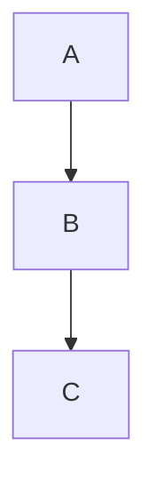
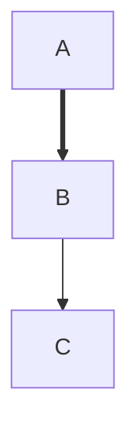

# 1. 基础 Markdown 语法

### 标题

```
# H1
## H2
### H3
#### H4
##### H5
###### H6
```

# H1
## H2
### H3
#### H4
##### H5
###### H6


### 粗体与斜体

```
*斜体*
_斜体_
**粗体**
__粗体__
***粗斜体***
___粗斜体___
```

*斜体*
_斜体_
**粗体**
__粗体__
***粗斜体***
___粗斜体___

### 删除线

```
~~删除线~~
```

~~删除线~~

### 高亮（Obsidian 扩展）

```
==高亮文字==
```

==高亮文字==

### 引用

```
> 引用内容
>> 嵌套引用
```

> 引用内容
>> 嵌套引用

### 无序列表

```
- 项目1
- 项目2
  - 子项目
* 也可以用星号
+ 或用加号
```

- 项目1
- 项目2
  - 子项目
* 也可以用星号
+ 或用加号

### 有序列表

```
1. 第一项
2. 第二项
   3. 子项（缩进）
```

1. 第一项
2. 第二项
   3. 子项（缩进）

### 任务列表（复选框）

```
- [ ] 未完成
- [x] 已完成
- [/] 部分完成
- [-] 已取消
- [>] 推迟
- [<] 计划
- [?] 疑问
- [!] 重要
- [*] 星标
- ["] 引文
- [l] 位置
- [b] 书签
- [i] 信息
- [S] 金钱
- [p] 赞成
- [c] 反对
- [f] 火
- [k] 键
- [w] 胜利
```

- [ ] 未完成
- [x] 已完成
- [/] 部分完成
- [-] 已取消
- [>] 推迟
- [<] 计划
- [?] 疑问
- [!] 重要
- [*] 星标
- [x] 引文
- [l] 位置
- [b] 书签
- [i] 信息
- [S] 金钱
- [p] 赞成
- [c] 反对
- [f] 火
- [k] 键
- [w] 胜利

### 水平线

```
---
***
___
```

---
***
___

### 链接

```
[显示文本](https://example.com)
[显示文本](相对路径/文件.md)
[显示文本](#锚点ID)
```

[显示文本](https://example.com)
[显示文本](相对路径/文件.md)
[显示文本](#锚点ID)

### 图片

```


```

### 内联代码

```
`代码`
```

`代码`

### 代码块

````
```语言名
代码行
```
````

```语言名
支持的语言包括但不限于：javascript, python, c, cpp, java, html, css, bash, sql, json, yaml, markdown, rust, go, ruby, php, typescript, lua, perl, r, swift, kotlin, scala, dart, elixir, haskell, clojure, erlang, fsharp, ocaml, nim, zig, crystal, d, groovy, powershell, makefile, diff, graphviz, mermaid 等。
```

### 表格

```
| 左对齐 | 居中对齐 | 右对齐 |
| :----- | :------: | -----: |
| 单元格 | 单元格   | 单元格 |
```

| 左对齐 | 居中对齐 | 右对齐 |
| :----- | :------: | -----: |
| 单元格 | 单元格   | 单元格 |

### 脚注

```
正文[1](@ref)

[1](@ref): 脚注内容
```

正文[1](@ref)

[1](@ref): 脚注内容

### 转义字符

```
\* 反斜杠转义
```

\* 反斜杠转义

## 2. Obsidian 特有语法

### 内部链接

```
[[笔记名称]]
[[笔记名称|显示别名]]
[[笔记名称#标题]]
[[笔记名称#^块ID]]
[[笔记名称#^块ID|别名]]
```

[[笔记名称]]
[[笔记名称|显示别名]]
[[笔记名称#标题]]
[[笔记名称#^块ID]]
[[笔记名称#^块ID|别名]]

### 嵌入内容

```
![[笔记名称]]
![[笔记名称#标题]]
![[笔记名称#^块ID]]
![[图片.png]]
![[PDF.pdf]]
```

### 标签

```
#标签
#项目/子标签
```

#标签
#项目/子标签

### Callout（提示框）

```
> [!note] 标题
> 内容

> [!abstract]
> 内容

> [!info]
> 内容

> [!todo]
> 内容

> [!tip]
> 内容

> [!success]
> 内容

> [!question]
> 内容

> [!warning]
> 内容

> [!failure]
> 内容

> [!danger]
> 内容

> [!bug]
> 内容

> [!example]
> 内容

> [!quote]
> 内容
```

> [!note] 标题
> 内容

> [!abstract]
> 内容

> [!info]
> 内容

> [!todo]
> 内容

> [!tip]
> 内容

> [!success]
> 内容

> [!question]
> 内容

> [!warning]
> 内容

> [!failure]
> 内容

> [!danger]
> 内容

> [!bug]
> 内容

> [!example]
> 内容

> [!quote]
> 内容

支持自定义折叠：

```
> [!faq]- 折叠标题
> 折叠内容
```

> [!faq]- 折叠标题
> 折叠内容

### LaTeX 数学公式

```
行内公式：$E=mc^2$
块级公式：
$$
\int_a^b f(x)dx
$$
```

行内公式：$E=mc^2$
块级公式：
$$
\int_a^b f(x)dx
$$

### Mermaid 图表

````

````



其他 Mermaid 类型
- sequenceDiagram
- classDiagram, stateDiagram
- gantt
- pie
- flowchart
- erDiagram

### 注释（仅编辑可见）

```
%% 这是注释 %%
```

%% 这是注释 %%

### 属性（YAML Front Matter）

```
---
title: 笔记标题
tags: [tag1, tag2]
date: 2023-01-01
aliases: [别名1, 别名2]
cssclass: my-custom-class
---
```

### 块引用与块ID

```
段落末尾添加 ^唯一ID

[[笔记#^唯一ID]] 引用该块
```

段落末尾添加 ^唯一ID

[[笔记#^唯一ID]] 引用该块

### 反向链接与图谱

```
- 点击笔记右侧的反向链接面板
- 使用 `[[` 创建链接后自动出现在图谱中
```

### 大纲（Outline）

```
- 使用 Ctrl/Cmd + O 打开大纲视图
- 基于标题自动生成
```
